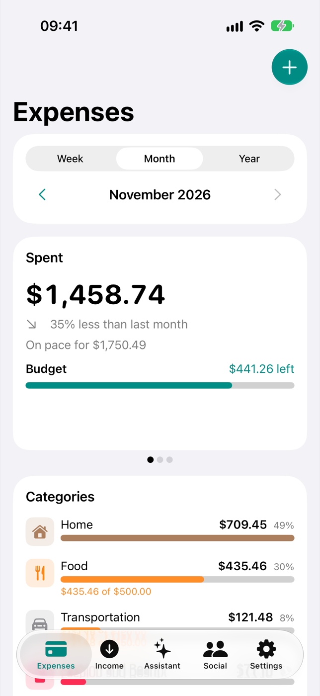
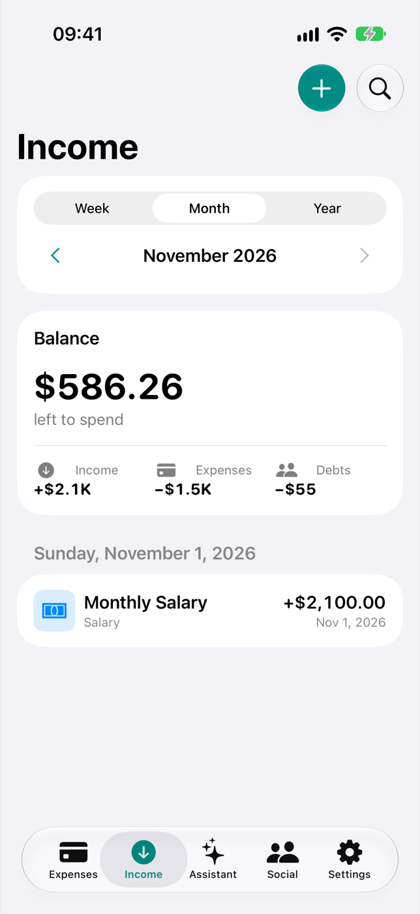
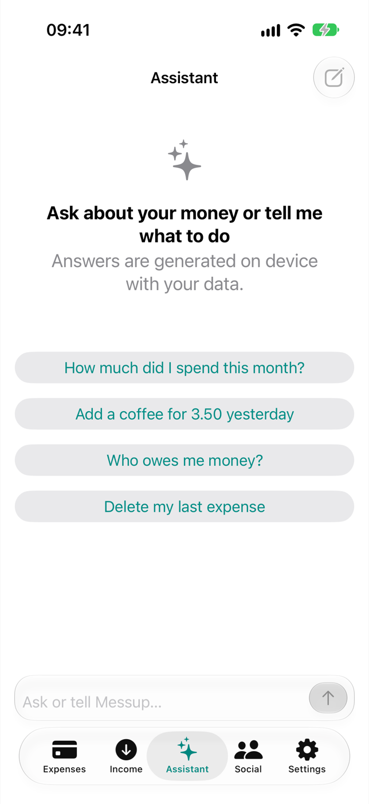
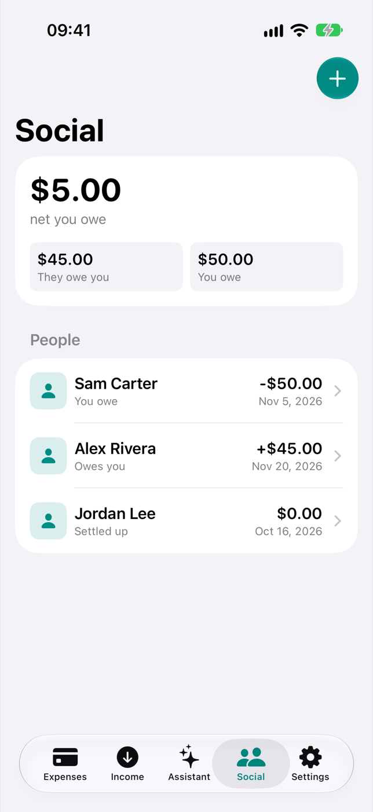
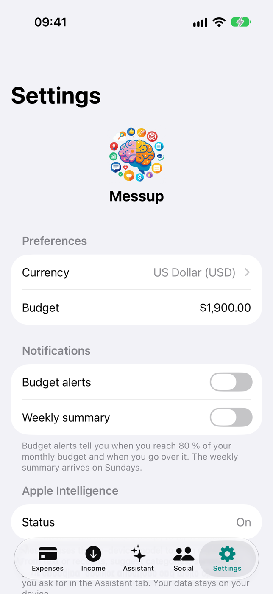
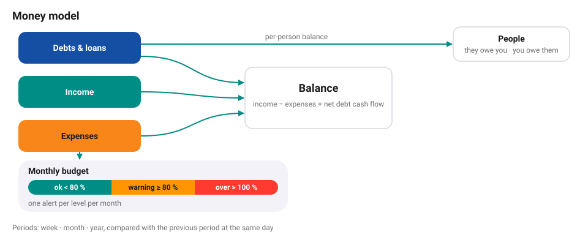
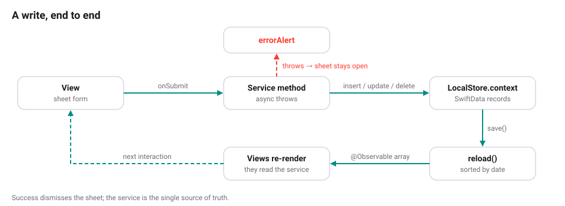
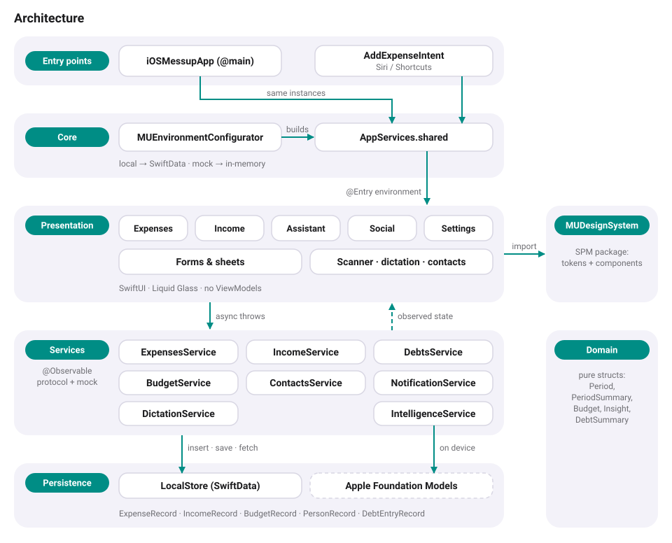
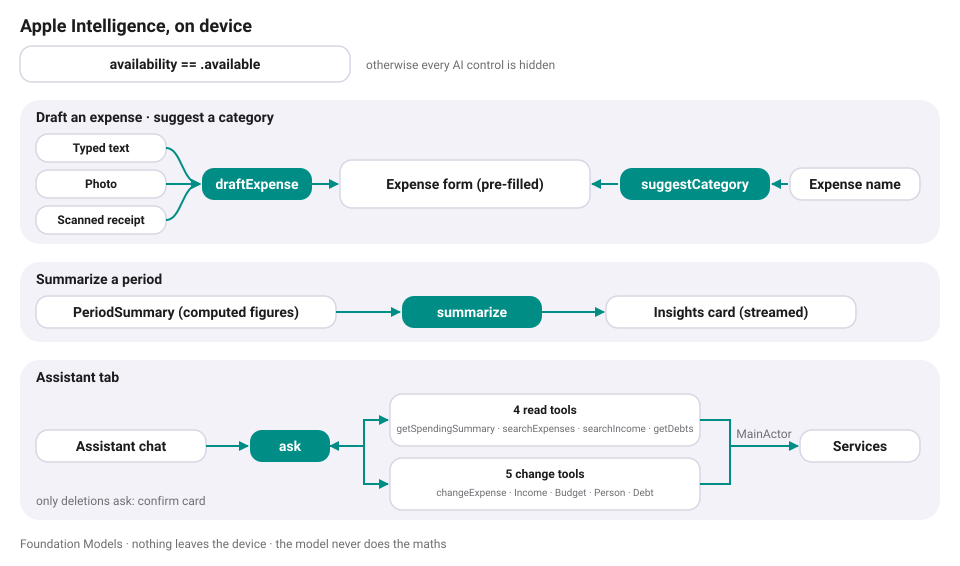
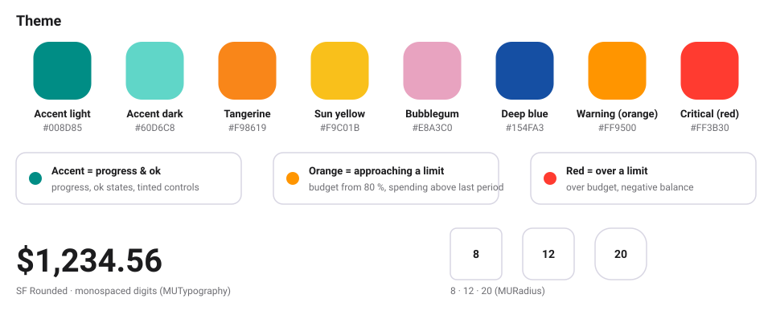

<p align="center"></p>

<h3 align="center">Expense &amp; payment tracking for the beautifully absent-minded.</h3>

<p align="center">
Messup is a local-first iOS tracker for expenses, income and money you share with other people. SwiftUI with Liquid Glass, SwiftData on the device, on-device Apple Intelligence. No backend, no account, no third-party dependencies.
</p>

<p align="center">
  
  
  
  
  
  
  <a href="LICENSE"></a>
</p>

<p align="center">
  <a href="https://rafasg13.github.io/ios-messup/">Website</a> ·
  <a href="#architecture">Architecture</a> ·
  <a href="ROADMAP.md">Roadmap</a> ·
  <a href="CONTRIBUTING.md">Contributing</a>
</p>

## Screenshots

<table align="center">
  <tr>
    <td align="center"><picture><source srcset="docs/screenshots/dark/expenses.png" media="(prefers-color-scheme: dark)"></picture></td>
    <td align="center"><picture><source srcset="docs/screenshots/dark/income.png" media="(prefers-color-scheme: dark)"></picture></td>
    <td align="center"><picture><source srcset="docs/screenshots/dark/assistant.png" media="(prefers-color-scheme: dark)"></picture></td>
    <td align="center"><picture><source srcset="docs/screenshots/dark/social.png" media="(prefers-color-scheme: dark)"></picture></td>
    <td align="center"><picture><source srcset="docs/screenshots/dark/settings.png" media="(prefers-color-scheme: dark)"></picture></td>
  </tr>
  <tr>
    <td align="center">Expenses</td>
    <td align="center">Income</td>
    <td align="center">Assistant</td>
    <td align="center">Social</td>
    <td align="center">Settings</td>
  </tr>
</table>

## Features

- **Money picture**: week / month / year periods; spent, change vs the previous period at the same day, daily average, end-of-period projection, cumulative chart vs the previous period, category breakdown, up to 3 insights.
- **Balance**: income − expenses + net debt cash flow, with the Income / Expenses / Debts split.
- **Social**: money lent to or borrowed from people (picked from Contacts or typed by hand), repayments, a balance per person, "Settle up", and a net summary of who owes whom.
- **Budgets & alerts**: monthly limit plus optional per-category limits; warning from 80 %, over above 100 %; opt-in local notifications (once per level per month) and a weekly Sunday reminder.
- **Apple Intelligence (on device)**: quick add from text, photo or scanned receipt; category suggestion; streamed period summary; an Assistant tab that answers questions and can create, update or delete expenses, income, budget, people and debts with tools (only deletions ask for confirmation); dictation fills the text field. Hidden when the model is unavailable.
- **Siri & Shortcuts**: "Add an expense in Messup" App Intent (amount, name, category, payment method), shares the running app's services.
- **Private by design**: SwiftData store on the device, no account, no network calls.
- **Yours**: any ISO currency, CSV export, light/dark, Dynamic Type up to accessibility sizes.

## How it works



Income is money in. A debt entry is money lent to or borrowed from a person, or a repayment; its cash flow counts toward the monthly balance, and the signed sum of a person's entries is what they owe you (or you owe them). The monthly budget is ok below 80 %, warning from 80 % and over above 100 %; each level alerts once per month.



A sheet form awaits an `async throws` service method, which writes through `LocalStore.context`, saves, and reloads its observable array sorted by date so every view re-renders. If the call throws, `errorAlert` shows the error and the sheet stays open.

## Architecture



Model-View, no ViewModels. Services are protocol-typed `@Observable` classes injected with `@Entry`; views read their state directly and call `async throws` methods. `AppServices.shared` holds the one set of services of the process, so `AddExpenseIntent` (Siri / Shortcuts) and the running app share the same instances. `MUEnvironmentConfigurator` builds either the `local` environment (SwiftData) or the `mock` one (in-memory sample data).

| Layer | Path | Contents |
|---|---|---|
| Domain | `iOSMessup/Domain` | Structs and pure logic: `Expense`, `Income`, `Person`, `DebtEntry`, `Period`, `PeriodSummary`, `Budget`, `DebtSummary`, `Insight` |
| Data | `iOSMessup/Data` | SwiftData records and `LocalStore`, services + mocks, CSV export, Intelligence |
| Presentation | `iOSMessup/Presentation` | Screens, forms, charts, view modifiers, navigation |
| Core | `iOSMessup/Core` | `AppServices`, `MUEnvironmentConfigurator`, currency, App Intents |
| Design system | `MUDesignSystem/` | Local SPM package: tokens (`MUSpacer`, `MURadius`, `MUTypography`, `Color.designSystem`) and components (`MUCard`, `MUIconTile`, `MUTransactionRow`, …) |
| Tests | `iOSMessupTests/` | Swift Testing suites (169 tests) |

## Apple Intelligence



- Foundation Models run on the device; nothing leaves it.
- The model is given computed figures (`PeriodSummary`) and is never asked to calculate. Nine tools (four read, five change data) keep the prompt inside the 4096-token context; records are addressed by short `#ref`s.
- Creates and updates apply at once and leave an activity card in the chat; deletions wait for the user to confirm.
- Every AI control is shown only when `IntelligenceServiceProtocol.availability == .available`.
- The live test (`LiveIntelligenceTests`) runs only on a device.

## Theme



The mint accent is the only brand color and nothing in the UI is green; orange and red are reserved for limits. Liquid Glass is used only on bars and controls, never on content cells.

## Tech stack

| Area | Technology |
|---|---|
| UI | SwiftUI, Liquid Glass, Swift Charts |
| Persistence | SwiftData |
| AI | Foundation Models (on device) |
| System integration | App Intents (phrases "Add an expense in Messup", "Log spending in Messup"), UserNotifications, VisionKit (document scanner, `Presentation/Components/DocumentScannerView.swift`), Speech (on-device dictation), Contacts |
| Concurrency | Swift 6, default MainActor isolation, Approachable Concurrency |
| Tests | Swift Testing |

## Requirements

- Xcode 27 or later (iOS 27 SDK)
- iOS 27.0+ device or simulator
- Apple Intelligence features need an eligible device with Apple Intelligence turned on; otherwise they are hidden. Contacts and microphone access are optional (people can be typed by hand; dictation only fills the text field).

## Getting started

```bash
git clone https://github.com/RafaSG13/ios-messup.git
cd ios-messup
open iOSMessup.xcodeproj
```

Build from the command line (get simulator ids from `xcrun simctl list devices available`):

```bash
xcodebuild -project iOSMessup.xcodeproj -scheme iOSMessup -destination 'id=<simulator-id>' build
```

Debug launch arguments:

| Argument | Effect |
|---|---|
| `-messup_environment mock` | In-memory sample data, nothing persisted |
| `-messup_autoseed NO` | Do not auto-seed an empty store (see the real empty state) |
| `-messup_seed_sample_data YES` | Replace the store with fresh sample data at every launch |

Debug builds auto-seed about 4 months of sample data into an empty store; Settings ▸ Debug can replace or delete it. Release builds contain none of this.

## Tests

```bash
xcodebuild -project iOSMessup.xcodeproj -scheme iOSMessupTests -destination 'id=<simulator-id>' test
```

The `iOSMessup` scheme has no testables; use `iOSMessupTests`. `LiveIntelligenceTests` run only on a device.

## Project structure

```
iOSMessup/
  Core/            AppServices, environment wiring, currency, App Intents
  Data/            Local (SwiftData), Services (+ Mock), Export (CSV)
  Domain/          Model, Period, PeriodSummary, Budget, Insights
  Presentation/    Views, Components, ViewModifiers, Navigation
  Localizable.xcstrings
MUDesignSystem/    Local SPM package (tokens + components)
iOSMessupTests/    Swift Testing suites
docs/              Pages site, diagrams, screenshots
```

## Roadmap

- Widgets and a Control Center control (App Group store first)
- Adaptive iPad layouts
- List filters, CSV import, passcode lock, iCloud sync
- Spanish localization and CI

Details in [ROADMAP.md](ROADMAP.md).

## Contributing

See [CONTRIBUTING.md](CONTRIBUTING.md) and [AGENTS.md](AGENTS.md) (architecture and conventions).

## License

MIT © 2025 Rafael Serrano Gamarra. See [LICENSE](LICENSE).
